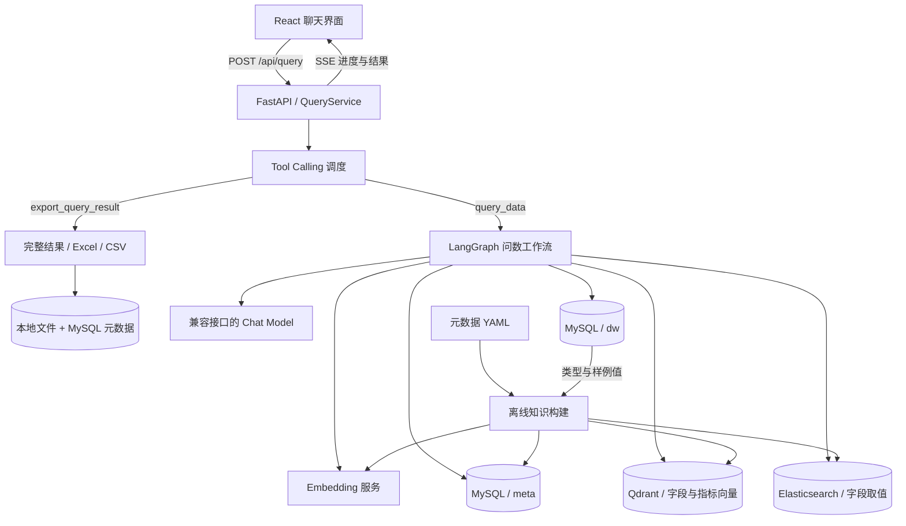

# Keeper · 数据智能查询 Agent

基于元数据检索增强与 Text-to-SQL 的自然语言数据库查询应用。提出问题后，系统检索相关字段、业务指标和真实取值，组装上下文，生成并校验 SQL，执行查询并实时展示处理进度与结果。

项目面向企业内部数据查询场景， 文档记录查询需要接入对应数据库表；文档正文解析、网页读取与报告归档属于后续规划。

## 当前能力

- **元数据知识构建**：从 YAML 加载表字段和指标定义，从数仓补充类型与样例值，分别写入元数据库、向量库与全文索引。
- **多路检索增强**：jieba TF-IDF 关键词抽取结合一次 LLM 统一查询扩展，并行召回字段、指标和真实字段取值。
- **上下文组装**：实体去重，补齐指标依赖字段、候选表主外键和取值样例，再通过一次 LLM 调用联合筛选相关表字段及指标，并补回依赖字段与主外键。
- **SQL 生成与执行**：结合日期、数据库方言与版本生成 SQL，通过 `EXPLAIN` 校验，失败时最多修复两次，每次修复后重新校验。
- **检索与观测**：字段及指标检索词跨路去重、分批向量化；三路检索各自限制最多 4 个并发请求，记录节点耗时、模型 Token 用量与筛选前后规模。
- **流式交互**：通过 SSE 展示节点状态、异常与查询结果，前端支持结果表格、样例问题及中止请求。
- **工具调用与导出**：外层 Agent 使用 Tool Calling 串行调用 `query_data` 和 `export_query_result`；复用问数 Graph，支持 Excel / CSV 下载及历史文件卡片恢复。

## 架构与技术栈



## 快速启动

以下命令在项目根目录执行，前端步骤除外。示例为本地开发方式：后端运行在宿主机，基础服务运行在 Docker 中。

### 1. 环境准备

- Python **3.14+** 与 uv，版本要求见 `pyproject.toml`。
- Node.js **22.12+**、pnpm **10.33.0**。
- Docker Engine / Docker Desktop 与 Docker Compose。
- 可访问的模型兼容接口及 API Key。
- 本地完整的 `bge-large-zh-v1.5` 模型目录。

### 2. 安装依赖与配置

```powershell
uv sync --locked
Copy-Item .env.example .env
Copy-Item conf/app_config.example.yaml conf/app_config.yaml
```

### 3. 构建元数据知识库

```powershell
uv run python -m app.scripts.build_meta_knowledge -c conf/meta_config.yaml
```

修改指标定义后，可独立同步指标：

```powershell
uv run python -m app.scripts.build_meta_knowledge -c conf/meta_config.yaml --metrics-only
```

### 4. 启动后端

```powershell
uv run uvicorn main:app --host 127.0.0.1 --port 8000 --reload
```

接口文档：[http://127.0.0.1:8000/docs](http://127.0.0.1:8000/docs)。

### 5. 启动前端

在另一个终端执行：

```powershell
cd frontend
pnpm install
Copy-Item .env.example .env
pnpm dev
```

## 能力边界与已知限制

- **SQL 可靠性**：`EXPLAIN` 不保证业务口径正确；修正后会重新校验，最多修复两次；查询理解阶段支持条件和指代澄清，但尚无检索后业务口径冲突检测。
- **执行约束**：只读要求主要来自提示词，尚无语句解析级限制、统一查询超时和强制结果上限。连接真实数据前需补齐约束并使用只读查询账号。
- **会话**：支持 MySQL 持久化与会话级连续追问；当前定位本地单用户，没有用户认证、跨会话偏好学习或长期向量记忆。
- **文档与报告**：尚无文件解析、网页读取、正文问答、报告生成及后台归档。
- **知识更新**：指标支持更新及旧向量清理；表字段和取值仍缺少完整增量同步及旧索引清理；筛选后会补回所选指标依赖字段及保留表的主外键，但尚无全局关联路径推导。
- **配置行为**：ES 仓储固定使用 `value_index`；Embedding 客户端由 `host` / `port` 决定连接，实际模型由 TEI 挂载配置决定，修改名称字段不会切换模型。
- **取消请求**：前端中止读取不代表已提交的数据库查询一定取消，当前没有显式数据库查询取消机制。
- **评测**：已有 20 条核心问题、参考答案和批量运行器；尚未完成整套 Agent 实测，暂无准确率及微调收益结论。

## 核心问数评测集

已基于当前演示库的只读一致性快照生成 20 条问题，覆盖筛选、关联、聚合、排名、AOV、去重、时间边界、占比、环比和空结果：

- [题目、口径、实际答案与参考 SQL](evals/core_queries.md)
- [机器可读评测数据](evals/core_queries.json)：包含预期列、行数、结果、排序要求及数值比较容差。

已提供[批量评测运行器](evals/README.md)，默认逐题执行现有 Agent，记录时间、SQL、实际答案、对比结果与错误：

```powershell
# 先跑前 3 题
uv run python -m evals.run --limit 3

# 完整运行
uv run python -m evals.run
```

报告写入独立的 `evals/reports/日期-时间-编号/`，每题完成后立即保存。运行需要基础服务和模型接口；会真实调用模型。`--dry-run` 仅检查格式，`--reference-only` 仅核验数据库参考答案，均不调用模型。

这套参考答案不代表 Agent 已通过评测。当前快照包含 115 条订单，日期范围为 2025-01-01 至 2025-03-31；文件记录数据指纹，库内数据改变后需重新核对。空结果题不能只凭执行结果为空判定 SQL 正确。

如需按当前本地数据库重新生成（会覆盖两份答案文件，不调用模型、不修改数据库）：

```powershell
uv run python -m evals.build_core_dataset
```

## 后续规划

- [ ] 建立 50～100 条问数评测集，记录参考 SQL、业务口径与预期结果。
- [x] 合并模型调用，补齐筛选后的字段依赖，增加修正后重校验与有限重试出口。
- [ ] 完善 SQL 静态检查、查询超时与结果上限。
- [ ] 增加口径澄清、运行记录和状态恢复。
- [ ] 实现知识构建幂等、增量同步和索引版本管理。
- [ ] 增加文件与网页工具，完成“分析 → 报告 → 后台保存”任务。
- [ ] 根据失败样本开展专项微调，用固定测试集报告真实收益。
